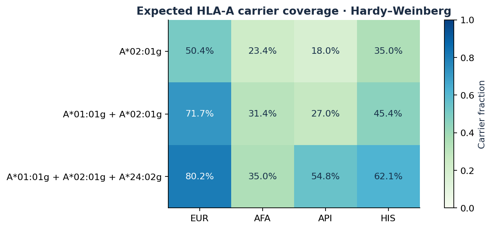

# HLA-A population coverage

**How much does expected carrier coverage change across historical HLA-A frequency tables?**

Compare three fixed sets of public HLA-A allele groups across four historical U.S. NMDP donor categories. Explore assumptions about diploid pairing in an interactive panel.

## Results

For the three-group set under Hardy–Weinberg pairing, expected coverage was **80.17% EUR**, **35.04% AFA**, **54.81% API** and **62.09% HIS**. The largest observed gap was **45.13 percentage points**. See [all scenario estimates](results/scenarios.csv) and launch the app to compare them.



## Methods

Sum the published frequency mass p of selected, disjoint allele groups. Under Hardy–Weinberg pairing, expected carrier coverage is 1 − (1 − p)². A simple sensitivity analysis subtracts Fp(1 − p), where F represents a hypothetical departure from random pairing. The spreadsheet's historical allele grouping and cohort codes are preserved.

## Reproduce

Use Python 3.12 in this repository.

```powershell
python -m venv .venv
.\.venv\Scripts\python -m pip install -r requirements.txt
.\.venv\Scripts\python analysis.py
.\.venv\Scripts\python -m unittest discover -v
```

On macOS and Linux, use `.venv/bin/python` in place of the Windows executable.
The analysis downloads public inputs into the ignored `raw/` cache.

Start the interface with `python -m streamlit run app.py`. Results in the repository are ready to explore after installing the requirements.

## Interpretation

The registry codes refer to categories defined by the original donor study. The analysis estimates HLA-A carrier frequencies at one locus. Treat the F scenarios as hypothetical departures from random pairing.

## Sources and licenses

[NMDP historical tables](https://network.nmdp.org/services-support/bioinformatics-immunobiology/haplotype-frequencies/high-resolution-hla-alleles-and-haplotypes-in-the-us-population) · [High-resolution allele study](https://doi.org/10.1016/j.humimm.2007.04.005)

Input URLs and hashes are recorded in [data/sources.json](data/sources.json). The MIT license applies to this repository's code. Original datasets, structures and external scores retain their source terms.
